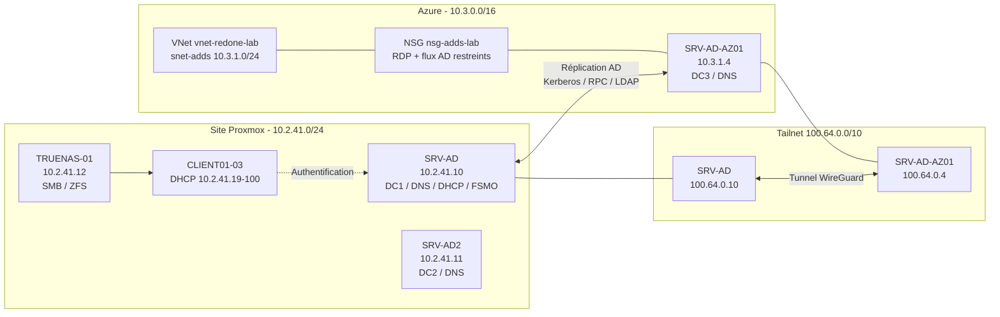

# AP_1 - Migration de l'Active Directory RedOne vers Azure

**Auteur :** Thibaut HUET
**Contexte :** BTS SIO option SISR - Atelier Professionnel
**Entreprise :** RedOne (infrastructure type GSB)
**Domaine :** `redone.local`
**Environnement existant :** Proxmox VE
**Cible :** Microsoft Azure, déployée en Infrastructure as Code (Bicep) via un pipeline GitHub Actions

---

## 1. Objectif du projet

L'entreprise RedOne dispose aujourd'hui d'une infrastructure Active Directory
hébergée sur Proxmox :

- `SRV-AD` (`10.2.41.10`) : contrôleur de domaine principal, DNS, DHCP, rôles FSMO ;
- `SRV-AD2` (`10.2.41.11`) : contrôleur de domaine secondaire, DNS ;
- `TRUENAS-01` (`10.2.41.12`) : stockage ZFS et partage SMB intégré au domaine ;
- `CLIENT01` à `CLIENT03` : postes clients joints au domaine ;
- `userdebian` : poste client Linux de test.

L'AP consiste à **migrer l'Active Directory vers Azure** en respectant une
démarche **DevOps / Infrastructure as Code** :

1. décrire toute l'infrastructure Azure dans du code **Bicep** versionné ;
2. automatiser le déploiement via **GitHub Actions** (CI/CD) ;
3. déployer un **nouveau contrôleur de domaine** Windows Server 2022 dans Azure ;
4. le raccorder au domaine existant via **Tailscale** (WireGuard) ;
5. laisser la **réplication native Active Directory** synchroniser utilisateurs,
   groupes, mots de passe (hachés), GPO et DNS ;
6. transférer les rôles **FSMO** puis **rétrograder** proprement le DC Proxmox.

> **Point clé :** on ne migre pas le disque de la VM Proxmox (`.qcow2`/`.vmdk`)
> vers Azure. Le « lift-and-shift » d'un contrôleur de domaine est dangereux
> (risque d'**USN Rollback** et de corruption de la base `NTDS.dit`).
> On déploie une VM **neuve** et on utilise la **réplication AD native**.

---

## 2. Ce que démontre ce livrable

| Axe | Mise en œuvre |
|---|---|
| **Infrastructure as Code** | Modules Bicep : VNet, NSG, NIC, VM, extensions, Key Vault |
| **CI/CD** | GitHub Actions : validation (`bicep build`/`lint`), `what-if`, déploiement |
| **Sécurité** | Secrets GitHub + paramètres `@secure()`, OIDC (pas de clé Azure stockée), NSG, aucune exposition RDP publique |
| **Réseau hybride** | Tailscale (WireGuard) entre Proxmox et Azure ; `GatewaySubnet` prévu pour ajouter une passerelle VPN IPsec |
| **Administration système** | Windows Server 2022, AD DS, DNS, promotion de DC, sites et services AD |
| **Migration** | Réplication AD, transfert FSMO, rétrogradation propre, validation `repadmin` / `dcdiag` |
| **Exploitation** | Scripts de validation, matrice de flux, plan d'adressage, procédure de rollback |

---

## 3. Architecture cible



Légende :

- **DC1 / DC2** : contrôleurs de domaine existants sur Proxmox.
- **DC3** : contrôleur de domaine **additionnel** dans Azure (le terme exact est
  « additional domain controller » ; AD fonctionne en réplication multimaître).
- **Tailscale** : réseau privé overlay WireGuard. Il remplace un tunnel IPsec
  site-à-site pour cet atelier : pas de passerelle VPN Azure facturée à l'heure,
  traversée de NAT automatique, chiffrement de bout en bout.
- **NSG** : filtre les flux entrants. L'accès RDP n'est pas exposé à Internet.

---

## 4. Correspondance avec l'infrastructure existante

| Élément | Existant (Proxmox) | Cible (Azure) |
|---|---|---|
| Domaine | `redone.local` | identique (réplication) |
| DC principal | `SRV-AD` - `10.2.41.10` | conservé pendant la migration |
| DC secondaire | `SRV-AD2` - `10.2.41.11` | conservé |
| Nouveau DC | - | `SRV-AD-AZ01` - `10.3.1.4` |
| DNS | `10.2.41.10`, `10.2.41.11` | `SRV-AD-AZ01` + DNS intégré AD |
| DHCP | `SRV-AD` | conservé (hors périmètre Azure) |
| Stockage | `TRUENAS-01` - `10.2.41.12` | conservé (SMB joint au domaine) |
| Clients | `CLIENT01-03`, `userdebian` | conservés |
| Interconnexion | LAN Proxmox | Tailscale / VPN IPsec (option) |

> Le plan d'adressage complet est dans [`docs/plan-adressage-ip.md`](docs/plan-adressage-ip.md).

---

## 5. Structure du dépôt

```text
AP_1/
├── .github/
│   └── workflows/
│       ├── validate.yml              # bicep build + lint (version autonome)
│       └── deploy-infra.yml          # what-if / deploiement (version autonome)
│
├── bicep/
│   ├── main.bicep                    # orchestrateur principal
│   ├── main.bicepparam               # parametres NON sensibles
│   └── modules/
│       ├── vnet.bicep                # VNet, snet-adds, GatewaySubnet optionnel
│       ├── nsg.bicep                 # regles RDP + replication AD
│       ├── vm-adds.bicep             # NIC IP fixe + VM Windows Server 2022
│       ├── extensions.bicep          # Tailscale -> jonction -> promotion AD
│       └── keyvault.bicep            # coffre de secrets optionnel
│
├── scripts/
│   ├── azure-dc/
│   │   ├── 01-setup-tailscale.ps1    # installation + connexion Tailscale
│   │   ├── 02-join-domain.ps1        # jonction manuelle de secours
│   │   ├── 03-promote-dc.ps1         # promotion en DC additionnel
│   │   ├── 04-validate-replication.ps1
│   │   ├── 05-transfer-fsmo.ps1      # transfert des 5 roles FSMO
│   │   └── 06-demote-onprem-dc.ps1   # retrogradation du DC Proxmox
│   ├── truenas/
│   │   ├── join-domain-truenas.md    # procedure de jonction TrueNAS
│   │   └── map-smb-shares.ps1        # mappage de secours du lecteur Z:
│   └── clients/
│       ├── join-domain-client.ps1    # jonction des postes clients
│       └── setup-tailscale-client.ps1
│
├── docs/
│   ├── architecture.md               # choix techniques et flux
│   ├── plan-adressage-ip.md          # plan d'adressage complet
│   ├── matrice-flux-ports.md         # ports AD / Azure / Tailscale
│   ├── procedure-deploiement.md      # runbook pas a pas
│   ├── competences-bts-sio.md        # tableau de competences SISR
│   └── troubleshooting.md            # erreurs courantes et resolutions
│
├── .gitignore
└── README.md
```

> **Important - emplacement des workflows**
> GitHub Actions ne lit que le dossier `.github/workflows/` **à la racine du
> dépôt**. Ce livrable contient donc deux copies :
> - `AP_1/.github/workflows/` : version autonome, si `AP_1` devient un dépôt dédié ;
> - `.github/workflows/ap1-*.yml` à la racine du dépôt `AP-BTS-SIO-SISR-V2` :
>   version **active** dans le dépôt actuel, avec les chemins préfixés `AP_1/`.

---

## 6. Prérequis

| Prérequis | Détail |
|---|---|
| Abonnement Azure | droits `Contributor` sur le resource group |
| Azure CLI | version 2.50+ (support `.bicepparam`) |
| Bicep CLI | installé par `az bicep install` |
| Tailscale | compte gratuit, agents sur `SRV-AD` et `SRV-AD-AZ01` |
| Proxmox | `SRV-AD` opérationnel, DNS et réplication fonctionnels |
| GitHub | dépôt, droits sur les secrets et variables, environnement `azure-lab` |
| Réseau | le DC Proxmox doit pouvoir joindre Internet pour Tailscale |

> **Ne pas exposer les contrôleurs de domaine directement sur Internet.**
> Tailscale crée un tunnel chiffré ; les flux AD ne transitent jamais en clair.

---

## 7. Mise en route rapide

### 7.1. Préparer Tailscale

1. Installer Tailscale sur `SRV-AD` et noter son IP `100.x.y.z`.
2. Dans la console Tailscale, fixer une **IP statique** pour `SRV-AD`
   (`100.64.0.10` dans ce livrable) et pour `SRV-AD-AZ01` (`100.64.0.4`).
3. Créer une clé d'authentification (`tskey-auth-...`) et la stocker dans
   GitHub Secrets `TAILSCALE_AUTH_KEY`.
4. Vérifier depuis `SRV-AD` : `tailscale status` et `tailscale ip -4`.

### 7.2. Configurer Azure et GitHub

Créer une app registration Azure avec fédération OIDC, puis renseigner :

**Variables GitHub** (`Settings > Secrets and variables > Actions > Variables`) :

| Variable | Exemple |
|---|---|
| `AZURE_CLIENT_ID` | `00000000-0000-0000-0000-000000000000` |
| `AZURE_TENANT_ID` | `00000000-0000-0000-0000-000000000000` |
| `AZURE_SUBSCRIPTION_ID` | `00000000-0000-0000-0000-000000000000` |
| `AZURE_RESOURCE_GROUP` | `rg-redone-adds-lab` |
| `AZURE_LOCATION` | `westeurope` |

**Secrets GitHub** :

| Secret | Contenu |
|---|---|
| `VM_ADMIN_PASSWORD` | mot de passe admin local de la VM Azure |
| `DOMAIN_JOIN_PASSWORD` | mot de passe de `REDONE\Administrateur` |
| `DSRM_PASSWORD` | mot de passe du mode restauration AD |
| `TAILSCALE_AUTH_KEY` | clé Tailscale |

La procédure détaillée (création de l'app registration, fédération OIDC,
moindre privilège) est dans [`docs/procedure-deploiement.md`](docs/procedure-deploiement.md).

### 7.3. Déployer

Option pipeline (recommandée) :

```text
GitHub > Actions > AP_1 - Deploy Azure AD Infrastructure > Run workflow
  action     = what-if   (puis deploy)
  promoteDc  = false     (phase 1 : VM + jonction uniquement)
```

> Un push sur `main` déploie la phase 1 (`promoteDc=false`). La promotion en
> contrôleur de domaine (phase 2) se fait uniquement via un lancement manuel
> avec `promoteDc=true`.

Option CLI :

```bash
export VM_ADMIN_PASSWORD='<mot de passe admin VM>'
export DOMAIN_JOIN_PASSWORD='<mot de passe REDONE\Administrateur>'
export DSRM_PASSWORD='<mot de passe DSRM>'
export TAILSCALE_AUTH_KEY='tskey-auth-...'

az group create --name rg-redone-adds-lab --location westeurope

az deployment group create \
  --resource-group rg-redone-adds-lab \
  --parameters AP_1/bicep/main.bicepparam
```

> `main.bicepparam` lit les secrets via `readEnvironmentVariable()` : aucun
> secret n'apparaît dans la ligne de commande ni dans le fichier de paramètres.

### 7.4. Valider

Sur `SRV-AD-AZ01` (via Tailscale/RDP) :

```powershell
Get-Service NTDS, DNS, Netlogon, KDC
Get-ADDomainController -Filter *
repadmin /replsummary
dcdiag /test:replications /test:advertising /test:dns
```

Résultat attendu : `repadmin` affiche **0 échec** et les deux ou trois DC
apparaissent. Le script `scripts/azure-dc/04-validate-replication.ps1` produit
un rapport complet.

### 7.5. Basculer (si l'objectif est de couper Proxmox)

1. Transférer les rôles FSMO : `scripts/azure-dc/05-transfer-fsmo.ps1`.
2. Vérifier de nouveau la réplication et le partage `SYSVOL`.
3. Rétrograder `SRV-AD` : `scripts/azure-dc/06-demote-onprem-dc.ps1`.
4. Ajuster DHCP/DNS des clients pour pointer vers le DC Azure.

> Ne jamais rétrograder un DC avant d'avoir vérifié que les rôles FSMO et
> `SYSVOL` sont bien répliqués sur le DC Azure.

---

## 8. Sécurité et gestion des secrets

- Aucun mot de passe n'est présent dans `main.bicep`, `main.bicepparam` ou le dépôt.
- Les paramètres sensibles sont marqués `@secure()` et injectés par GitHub Secrets.
- L'extension Azure transmet les secrets via `protectedSettings` (chiffrés,
  non journalisés).
- Le pipeline utilise **OIDC** : pas de `AZURE_CREDENTIALS` (clé JSON) stocké.
- Le NSG n'autorise pas RDP depuis Internet ; l'accès se fait par Tailscale.
- Le Key Vault est **optionnel** (`deployKeyVault=true`) : il conserve les
  secrets pour l'audit et la rotation. La VM, elle, reçoit ses secrets par le
  pipeline pour éviter le problème « poule et œuf » du plan de données.

> En production, ajouter : Azure Bastion ou Just-in-Time, Defender for Cloud,
> Azure Policy, sauvegarde du DC (Azure Backup), et un second DC Azure dans une
> zone de disponibilité différente.

---

## 9. Choix techniques et justifications

| Choix | Justification |
|---|---|
| **Bicep** plutôt que portail | reproductibilité, revue de code, historique Git, déploiement idempotent |
| **VM neuve + réplication** plutôt que conversion `.qcow2` | évite l'USN Rollback et les incohérences de base AD |
| **Tailscale** plutôt que VPN IPsec | simplicité, NAT traversal, coût nul côté Azure ; `deployVpnGateway=true` prépare le `GatewaySubnet` pour une passerelle IPsec |
| **Extension `JsonADDomainExtension`** | jonction gérée nativement par Azure, redémarrage pris en charge |
| **CustomScriptExtension** pour AD DS | automatise l'installation du rôle et la promotion |
| **DC additionnel** | continuité de service, réplication multimaître, pas de bascule brutale |
| **Sites et services AD** | maîtrise des flux de réplication entre Proxmox et Azure |
| **Aucun RDP entrant depuis Internet** | l'IP publique sert à la sortie ; le NSG filtre l'administration |

---

## 10. Coût et nettoyage

Ordre de grandeur (à vérifier sur le calculateur Azure) :

- `Standard_B2ms` : environ 60 à 70 €/mois si la VM reste allumée 24/7 ;
- disque `StandardSSD_LRS` 127 Go : quelques euros par mois ;
- IP publique Standard : quelques euros par mois ;
- Tailscale : offre gratuite suffisante pour l'AP ;
- pas de passerelle VPN Azure (économie d'environ 25 à 30 €/mois).

**Pour arrêter les frais :**

```bash
# Desallouer la VM (les disques restent factures)
az vm deallocate -g rg-redone-adds-lab -n SRV-AD-AZ01

# Ou supprimer tout le resource group de test
az group delete --name rg-redone-adds-lab --yes --no-wait
```

> Attention : supprimer le resource group supprime la VM et son disque. En
> production, sauvegarder l'état système du DC avant toute suppression.

---

## 11. Limites connues / pistes d'amélioration

- Un seul DC dans Azure : pour une vraie haute disponibilité, en déployer un
  second dans une autre zone de disponibilité.
- Le DC Azure dépend de Tailscale pour joindre le DC on-prem pendant la migration.
- Les extensions Azure peuvent afficher un statut `failed` lorsque la VM
  redémarre pendant la promotion : c'est documenté dans
  [`docs/troubleshooting.md`](docs/troubleshooting.md).
- Le DHCP n'est pas migré dans cette AP (il reste sur `SRV-AD`), sauf si
  l'objectif est la fermeture complète du site Proxmox.
- La clé Tailscale utilisée doit être révoquée après le déploiement.

---

## 12. Compétences BTS SIO SISR mobilisées

Le détail est dans [`docs/competences-bts-sio.md`](docs/competences-bts-sio.md).
Synthèse :

- **B1.1** Gérer le patrimoine informatique (inventaire, plan d'adressage) ;
- **B1.2** Répondre aux incidents (réplication, DNS, dépannage) ;
- **B1.4** Travailler en mode projet (Git, pipeline, documentation) ;
- **B1.5** Mettre à disposition un service (AD DS, DNS, SMB) ;
- **B2.1** Concevoir une solution d'infrastructure (architecture hybride) ;
- **B2.2** Installer, tester et déployer (Bicep, extensions, PowerShell) ;
- **B2.3** Exploiter, dépanner et superviser (repadmin, dcdiag, journaux).

---

## 13. Documentation détaillée

| Document | Contenu |
|---|---|
| [`docs/architecture.md`](docs/architecture.md) | architecture, flux, choix, sécurité |
| [`docs/plan-adressage-ip.md`](docs/plan-adressage-ip.md) | plan IP on-prem / Azure / Tailscale |
| [`docs/matrice-flux-ports.md`](docs/matrice-flux-ports.md) | ports et règles NSG |
| [`docs/procedure-deploiement.md`](docs/procedure-deploiement.md) | runbook complet, OIDC, sites AD, FSMO |
| [`docs/competences-bts-sio.md`](docs/competences-bts-sio.md) | tableau de compétences pour le jury |
| [`docs/troubleshooting.md`](docs/troubleshooting.md) | erreurs fréquentes et résolutions |
| [`scripts/truenas/join-domain-truenas.md`](scripts/truenas/join-domain-truenas.md) | jonction TrueNAS au domaine |

---

## 14. Avertissement

Ce projet est un **laboratoire pédagogique**. Les mots de passe fournis dans les
anciens documents (`Serveur2022`) sont des mots de passe de maquette et ne
doivent jamais être réutilisés en production. Les secrets réels doivent être
générés aléatoirement, stockés dans un coffre et renouvelés.
