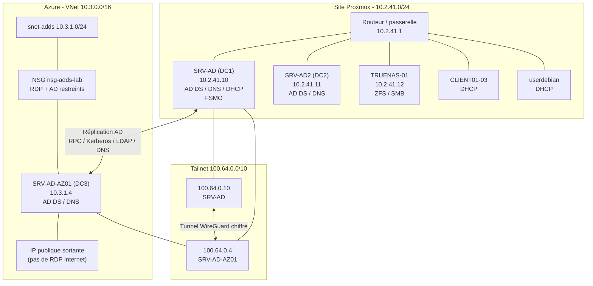

# Architecture et choix techniques - AP_1

## 1. Vue d'ensemble

L'architecture est **hybride** : le site Proxmox de RedOne reste la référence
Active Directory pendant toute la durée de la migration, tandis qu'un nouveau
contrôleur de domaine est déployé dans Azure. Les deux sites communiquent via un
réseau privé overlay **Tailscale** (WireGuard).



> Les adresses Tailscale `100.64.0.10` et `100.64.0.4` sont des conventions de
> ce livrable. Il faut les fixer explicitement dans la console Tailscale
> (`Machines > ... > Edit > IPv4 address`) pour qu'elles soient stables.

---

## 2. Rôles des composants

| Composant | Rôle | Emplacement |
|---|---|---|
| `SRV-AD` | DC principal, DNS, DHCP, rôles FSMO | Proxmox |
| `SRV-AD2` | DC secondaire, DNS | Proxmox |
| `SRV-AD-AZ01` | DC additionnel, DNS intégré AD | Azure |
| `TRUENAS-01` | Stockage ZFS, partage SMB authentifié AD | Proxmox |
| `CLIENT01-03` | Postes clients Windows joints au domaine | Proxmox |
| `VNet 10.3.0.0/16` | Réseau virtuel Azure | Azure |
| `snet-adds 10.3.1.0/24` | Sous-réseau du DC Azure | Azure |
| `nsg-adds-lab` | Filtrage des flux entrants | Azure |
| `kv-*` (optionnel) | Coffre de secrets pour audit/rotation | Azure |
| Tailscale | Interconnexion privée chiffrée | Overlay |

---

## 3. Pourquoi un DC additionnel et pas une conversion de VM ?

Migrer un contrôleur de domaine en copiant son disque virtuel (`.qcow2`,
`.vmdk`, `.vhd`) est une pratique risquée :

- **USN Rollback** : la base `NTDS.dit` contient un numéro de séquence (USN).
  Une restauration ou une copie à chaud peut faire « reculer » ce numéro et
  désynchroniser définitivement le DC.
- **Identité machine / secrets** : les secrets de compte machine et les tickets
  Kerberos peuvent être incohérents après clonage.
- **Matériel différent** : Azure utilise un hyperviseur et des pilotes
  différents ; une VM Proxmox n'est pas directement bootable dans Azure.
- **Continuité de service** : la réplication permet aux deux DC de fonctionner
  en parallèle pendant la migration.

La méthode retenue est donc :

```text
Déploiement d'une VM neuve (Bicep)
        ↓
Jonction au domaine existant
        ↓
Promotion en DC additionnel
        ↓
Réplication native (NTDS + SYSVOL + DNS)
        ↓
Transfert FSMO puis rétrogradation de l'ancien DC
```

---

## 4. Réplication Active Directory

La réplication AD n'est **pas une fonctionnalité Azure** : c'est un mécanisme
natif de Windows Server. Elle fonctionne dès que deux DC peuvent communiquer sur
les ports AD (voir la matrice de flux).

| Donnée répliquée | Contenu |
|---|---|
| Partition de domaine | utilisateurs, groupes, ordinateurs, GPO |
| Partition de configuration | sites, liens de réplication, DC |
| Partition de schéma | définition des objets |
| Zones DNS intégrées AD | enregistrements `_msdcs`, `_sites`, `_tcp`, `_udp` |
| `SYSVOL` | scripts de démarrage, GPO, fichiers publics |

### Sites et services Active Directory

Pour que la réplication soit optimisée, créer deux sites AD :

| Site AD | Sous-réseaux associés | DC |
|---|---|---|
| `Site-Proxmox` | `10.2.41.0/24` | `SRV-AD`, `SRV-AD2` |
| `Site-Azure` | `10.3.1.0/24`, `100.64.0.0/10` | `SRV-AD-AZ01` |

Le sous-réseau `100.64.0.0/10` est important : il permet à AD de rattacher
correctement le DC Azure au site `Site-Azure` lorsque la réplication passe par
l'adresse Tailscale.

Créer les sites **avant** la promotion (sur `SRV-AD`) :

```powershell
New-ADReplicationSite -Name 'Site-Azure'
New-ADReplicationSubnet -Name '10.3.1.0/24' -Site 'Site-Azure'
New-ADReplicationSubnet -Name '100.64.0.0/10' -Site 'Site-Azure'
New-ADReplicationSiteLink -Name 'LINK-Proxmox-Azure' `
    -SitesIncluded 'Site-Proxmox','Site-Azure' `
    -Cost 10 -ReplicationFrequencyInMinutes 15 `
    -InterSiteTransportProtocol IP
```

> Si le site Proxmox porte encore le nom `Default-First-Site-Name`, utilisez ce
> nom dans `-SitesIncluded`, ou renommez-le au préalable.

### Vérifications

```powershell
repadmin /replsummary
repadmin /showrepl
dcdiag /test:replications /test:advertising /test:dns
Get-ADDomainController -Filter * | Format-Table Name, Site, IPv4Address
Get-Service NTDS, DNS, Netlogon, KDC
```

---

## 5. Tailscale ou VPN IPsec ?

| Critère | VPN IPsec site-à-site | Tailscale (WireGuard) |
|---|---|---|
| Complexité | élevée : IP publiques, IKEv2, NAT, pare-feu | faible : un agent, une clé |
| Coût Azure | passerelle VPN facturée à l'heure (~25-30 €/mois) | gratuit (offre personnelle) |
| Traversée de NAT | dépend du routeur / DynDNS | automatique |
| Chiffrement | IPsec | WireGuard (ChaCha20-Poly1305) |
| Flux AD | ports AD à ouvrir sur le pare-feu | encapsulés dans le tunnel overlay |
| Adapté au BTS | oui, architecture « entreprise » | oui, plus rapide à mettre en œuvre |

Le code Bicep prévoit les deux modes :

- `deployVpnGateway = false` (défaut) : mode Tailscale, pas de `GatewaySubnet` ;
- `deployVpnGateway = true` : crée un `GatewaySubnet` pour ajouter ensuite une
  `VirtualNetworkGateway` et un `LocalNetworkGateway` (non inclus dans ce
  livrable, car ils nécessitent l'IP publique du site Proxmox).

> Tailscale est un choix pragmatique pour l'AP. En entreprise, un VPN IPsec ou
> ExpressRoute reste la norme pour un réseau hybride permanent.

---

## 6. Flux réseau

### 6.1. Pendant la migration

| Source | Destination | Port | Usage |
|---|---|---|---|
| Extension Azure | Internet (GitHub raw) | 443/TCP | téléchargement des scripts |
| VM Azure | Azure DNS `168.63.129.16` | 53/UDP | résolution Internet au premier boot |
| VM Azure | `SRV-AD` (Tailscale `100.64.0.10`) | 53/UDP | résolution de `redone.local` via NRPT |
| VM Azure | Tailscale | 443/TCP + 41641/UDP | contrôle et tunnel |
| `SRV-AD-AZ01` | `SRV-AD` (Tailscale) | 88, 135, 389, 445, 464, 636, 3268-3269, RPC | jonction, réplication |
| `SRV-AD` | `SRV-AD-AZ01` | mêmes ports | réplication entrante |
| Admin | `SRV-AD-AZ01` | 3389/TCP via Tailscale | RDP |

### 6.2. Après la migration

| Source | Destination | Port | Usage |
|---|---|---|---|
| Clients | DC Azure (via VPN/Tailscale) | 53, 88, 389, 445, 636 | authentification, DNS, GPO |
| Clients | TrueNAS | 445/TCP | partage SMB |
| DC Azure | Internet | 123/UDP | NTP (ou source interne) |
| DC Azure | Sauvegarde Azure | 443/TCP | sauvegarde de l'état système |

Le détail est dans [`matrice-flux-ports.md`](matrice-flux-ports.md).

### 6.3. Résolution DNS : le point délicat du premier boot

Une VM Azure neuve doit résoudre **Internet** (pour télécharger l'installateur
Tailscale et les scripts) **avant** que Tailscale ne soit connecté. Si l'on met
directement `100.64.0.10` comme DNS sur la carte réseau Azure, la VM ne peut
plus résoudre `pkgs.tailscale.com` : c'est le problème « poule et œuf ».

La solution retenue :

1. la NIC Azure conserve le DNS de la plateforme `168.63.129.16` pour Internet ;
2. le script `01-setup-tailscale.ps1` installe Tailscale ;
3. il crée une règle **NRPT** (`Name Resolution Policy Table`) :
   `*.redone.local` -> `100.64.0.10` via Tailscale ;
4. la jonction de domaine et la promotion utilisent cette règle ;
5. après promotion, le script `04-validate-replication.ps1` bascule la règle
   vers `100.64.0.4` (le DC Azure lui-même).

Tailscale est lancé avec `--accept-dns=false` : il ne remplace donc pas le DNS
de la NIC Azure. L'interface Tailscale est passée en profil réseau `Private`
pour que le pare-feu Windows autorise les flux AD et RDP entrants.

Commandes de contrôle :

```powershell
Get-DnsClientNrptRule | Where-Object Namespace -contains '.redone.local'
Resolve-DnsName pkgs.tailscale.com
Resolve-DnsName redone.local
```

> Cette approche est plus robuste qu'un DNS on-prem fixé sur la NIC : elle
> survit aux redémarrages et évite de dépendre de l'ordre d'initialisation des
> interfaces.

---

## 7. Sécurité

### 7.1. Surface d'attaque

- **Pas de RDP exposé à Internet** : le NSG n'autorise que les réseaux
  d'administration (`10.2.41.0/24`, `100.64.0.0/10`).
- **IP publique** : utilisée pour le trafic sortant (extensions, mises à jour,
  Tailscale) ; elle ne donne pas accès au RDP.
- **Secrets** : GitHub Secrets + paramètres `@secure()` ; jamais dans Git.
- **OIDC** : le pipeline s'authentifie sans clé stockée.
- **Key Vault** : optionnel, avec purge protection et accès limité.

### 7.2. Bonnes pratiques AD

- Chaque DC doit avoir une IP fixe et un DNS fiable.
- Ne jamais éteindre un DC sans vérifier la réplication et les FSMO.
- Sauvegarder l'état système (`wbadmin start systemstatebackup`) avant toute
  opération de rétrogradation.
- Surveiller `repadmin /replsummary` et les journaux `Directory Service`.
- Synchroniser l'heure : Kerberos tolère moins de 5 minutes de décalage.

---

## 8. Scénarios de panne

| Scénario | Impact | Réaction |
|---|---|---|
| Tailscale tombe | le DC Azure ne joint plus le DC on-prem | vérifier `tailscale status`, relancer le service |
| `SRV-AD` tombe | authentification assurée par `SRV-AD2` | basculer les FSMO si nécessaire |
| `SRV-AD2` tombe | `SRV-AD` assure le service | remplacer / reconstruire le DC |
| DC Azure tombe | service assuré par Proxmox | redéployer via Bicep |
| Corruption `NTDS` | perte de données potentielle | restauration système, jamais de snapshot à chaud |
| Erreur de réplication | incohérence d'annuaire | `repadmin /showrepl`, `dcdiag`, corriger le DNS |

---

## 9. Limites de l'architecture

- Un seul DC Azure : pas de haute disponibilité intra-cloud.
- Le DC Azure dépend de Tailscale pour la réplication initiale.
- Le DHCP reste sur Proxmox.
- Les scripts d'extension sont téléchargés depuis GitHub : le dépôt doit être
  public, ou utiliser un compte de stockage avec SAS.
- Le pipeline applique les changements sur `main` : en production, ajouter une
  approbation manuelle (environnement protégé) et un `what-if` obligatoire.

---

## 10. Évolutions possibles

1. Ajouter un second DC Azure dans une autre zone de disponibilité.
2. Remplacer l'IP publique par un **NAT Gateway** et supprimer l'exposition
   sortante directe.
3. Ajouter **Azure Bastion** pour l'administration sans Tailscale.
4. Migrer le DHCP vers Azure (ou le conserver sur site selon le besoin).
5. Ajouter **Azure Backup** et des tests de restauration.
6. Ajouter **Azure Monitor / Log Analytics** pour les journaux AD.
7. Étendre le pipeline avec `what-if` obligatoire, tests Pester et analyse
   `bicep lint` en pré-commit.
