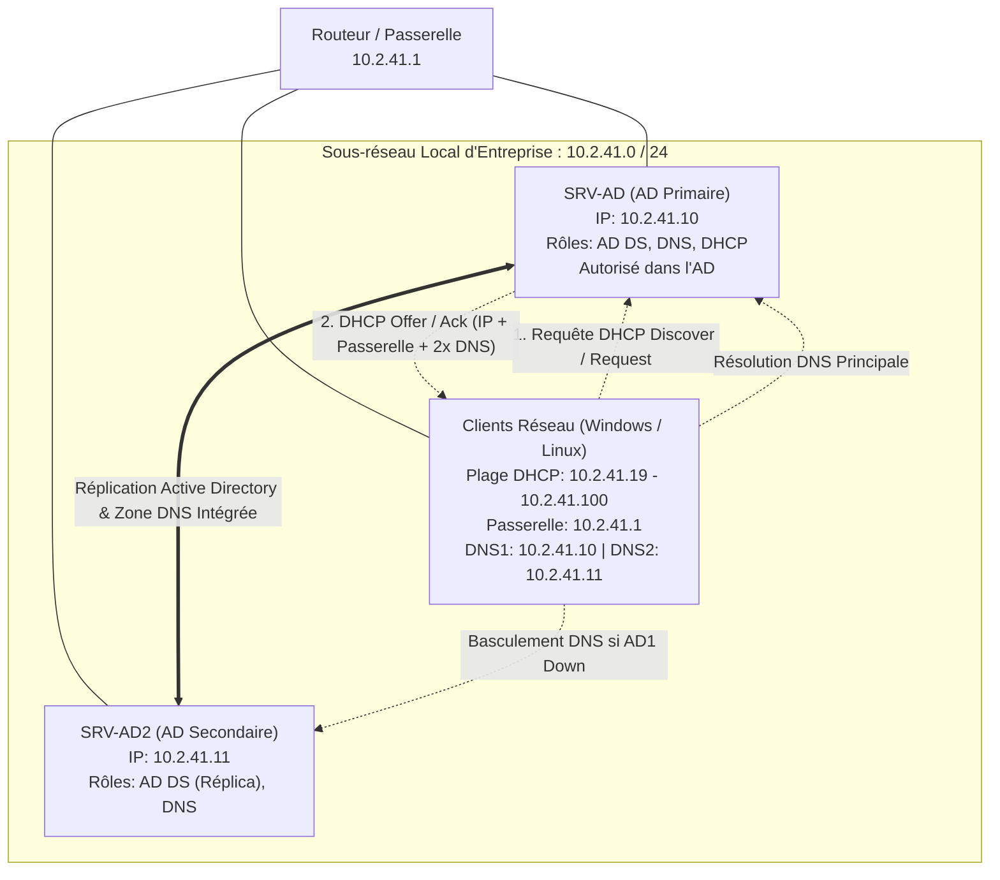

# Déploiement d'un Serveur DHCP et d'un Contrôleur de Domaine Secondaire (Haute Disponibilité AD DS & DNS)

**Auteur :** Thibaut HUET  
**Date :** Octobre 2026  
**Contexte :** Projet AP BTS SIO (Option SISR) — Infrastructure d'Entreprise RedOne / GSB  
**Environnement :** Hyperviseur Proxmox VE — Windows Server 2022 Standard (Desktop Experience)  

---

## Table des matières

1. [Contexte du Projet et Objectifs Techniques](#1-contexte-du-projet-et-objectifs-techniques)
2. [Architecture Réseau et Plan d'Adressage](#2-architecture-réseau-et-plan-dadressage)
3. [Partie I : Installation et Configuration du Serveur DHCP sur le Contrôleur Primaire (`SRV-AD`)](#3-partie-i--installation-et-configuration-du-serveur-dhcp-sur-le-contrôleur-primaire-srv-ad)
   - [3.1 Installation du Rôle Serveur DHCP](#31-installation-du-rôle-serveur-dhcp)
   - [3.2 Configuration Post-Déploiement et Autorisation dans l'AD](#32-configuration-post-déploiement-et-autorisation-dans-lad)
   - [3.3 Création et Paramétrage de l'Étendue IPv4](#33-création-et-paramétrage-de-létendue-ipv4)
   - [3.4 Configuration des Options d'Étendue (Passerelle, Domaine, DNS Primaire)](#34-configuration-des-options-détendue-passerelle-domaine-dns-primaire)
   - [3.5 Ajout du Serveur DNS Secondaire pour la Redondance](#35-ajout-du-serveur-dns-secondaire-pour-la-redondance)
4. [Partie II : Déploiement et Promotion du Contrôleur de Domaine Secondaire (`SRV-AD2`)](#4-partie-ii--déploiement-et-promotion-du-contrôleur-de-domaine-secondaire-srv-ad2)
   - [4.1 Spécifications et Prérequis Système de la VM](#41-spécifications-et-prérequis-système-de-la-vm)
   - [4.2 Configuration IP Statique de la Carte Réseau](#42-configuration-ip-statique-de-la-carte-réseau)
   - [4.3 Installation du Rôle Services de Domaine Active Directory (AD DS)](#43-installation-du-rôle-services-de-domaine-active-directory-ad-ds)
   - [4.4 Promotion en Contrôleur de Domaine dans le Domaine Existant](#44-promotion-en-contrôleur-de-domaine-dans-le-domaine-existant)
   - [4.5 Réplication Active Directory et Intégration DNS](#45-réplication-active-directory-et-intégration-dns)
5. [Tests, Vérifications et Commandes de Validation](#5-tests-vérifications-et-commandes-de-validation)
   - [5.1 Validation du Service DHCP et Distribution IP](#51-validation-du-service-dhcp-et-distribution-ip)
   - [5.2 Validation de la Réplication Active Directory](#52-validation-de-la-réplication-active-directory)
   - [5.3 Test de Tolérance aux Pannes DNS](#53-test-de-tolérance-aux-pannes-dns)
6. [Bonnes Pratiques et Sécurité SISR](#6-bonnes-pratiques-et-sécurité-sisr)
7. [Fiche de Synthèse des Compétences BTS SIO SISR](#7-fiche-de-synthèse-des-compétences-bts-sio-sisr)
8. [Conclusion](#8-conclusion)

---

## 1. Contexte du Projet et Objectifs Techniques

Dans le cadre du projet d'Atelier Professionnel (AP) au sein de la PME **RedOne** (infrastructure type GSB), un premier contrôleur de domaine (`SRV-AD.redone.local`) a été déployé pour centraliser la gestion des identités, des accès et des politiques de sécurité (GPO).

Cependant, une infrastructure reposant sur un unique contrôleur de domaine et un seul serveur DNS présente un risque critique : le **SPOF (*Single Point of Failure*)**. En cas de panne matérielle, de maintenance ou de défaillance du serveur primaire, l'authentification des utilisateurs, l'accès aux partages et la résolution de noms de l'ensemble de l'entreprise seraient totalement paralysés.

De plus, l'adressage IP des postes clients doit être fiabilisé et automatisé afin d'éviter les conflits d'adresses tout en fournissant automatiquement les paramètres réseau optimaux (passerelle et serveurs DNS redondants).

### Objectifs Opérationnels

1. **Déploiement du rôle Serveur DHCP** sur le contrôleur de domaine primaire (`10.2.41.10`) :
   - Autoriser officiellement le serveur DHCP dans l'annuaire Active Directory.
   - Définir une plage d'attribution dynamique pour les clients et serveurs membres : `10.2.41.19` à `10.2.41.100`.
   - Réserver et exclure les adresses statiques des serveurs d'infrastructure (`10.2.41.10` et `10.2.41.11`).
   - Configurer les options DHCP critiques : Passerelle par défaut (`10.2.41.1`), Domaine de recherche (`redone.local`), Serveur DNS préféré (`10.2.41.10`) et Serveur DNS auxiliaire (`10.2.41.11`).
2. **Déploiement d'un Contrôleur de Domaine Secondaire (AD Réplica)** :
   - Installer une seconde machine virtuelle Windows Server 2022 sous Proxmox.
   - Configurer l'adressage IP fixe en `10.2.41.11/24` avec pointage DNS croisé vers `10.2.41.10`.
   - Installer le rôle **AD DS** et promouvoir la machine comme contrôleur additionnel du domaine existant `redone.local`.
   - Assurer la réplication bidirectionnelle de la base de données d'annuaire (NTDS) et des zones DNS intégrées à Active Directory.
3. **Mise en place de la Haute Disponibilité DNS** :
   - Garantir que si le DNS primaire `10.2.41.10` devient indisponible, les postes clients basculent automatiquement vers le DNS secondaire `10.2.41.11` sans interruption de service pour les utilisateurs.

---

## 2. Architecture Réseau et Plan d'Adressage

### Plan d'Adressage IP

| Équipement / Rôle | Nom d'hôte (FQDN) | Adresse IP | Masque | Passerelle | DNS Préféré | DNS Auxiliaire | Type d'attribution |
|---|---|---|---|---|---|---|---|
| **Passerelle / Routeur** | `router.redone.local` | `10.2.41.1` | `255.255.255.0` | - | - | - | Fixe |
| **Contrôleur AD 1 / DNS 1 / DHCP** | `SRV-AD.redone.local` | `10.2.41.10` | `255.255.255.0` | `10.2.41.1` | `10.2.41.10` | `10.2.41.11` | Fixe (Statique) |
| **Contrôleur AD 2 / DNS 2** | `SRV-AD2.redone.local` *(WIN-VIGJM1U220)* | `10.2.41.11` | `255.255.255.0` | `10.2.41.1` | `10.2.41.10` | `10.2.41.11` | Fixe (Statique) |
| **Plage dynamique Clients DHCP** | Postes Windows / Linux | `10.2.41.19` - `10.2.41.100` | `255.255.255.0` | `10.2.41.1` | `10.2.41.10` | `10.2.41.11` | Dynamique (Bail 8j) |
| **Client Linux de Test** | `userdebian.redone.local` | `10.2.41.X` (DHCP) | `255.255.255.0` | `10.2.41.1` | `10.2.41.10` | `10.2.41.11` | Dynamique / Fixe |

### Diagramme de Topologie et Flux Réseau



---

## 3. Partie I : Installation et Configuration du Serveur DHCP sur le Contrôleur Primaire (`SRV-AD`)

### 3.1 Installation du Rôle Serveur DHCP

L'installation du rôle DHCP s'effectue directement sur le premier contrôleur de domaine `SRV-AD.redone.local` à l'aide de l'assistant du **Gestionnaire de serveur**.

#### Étape 1 : Ouverture de l'Assistant d'Ajout de Rôles
1. Ouvrir le **Gestionnaire de serveur**.
2. Dans le menu supérieur droit, cliquer sur **Gérer** > **Ajouter des rôles et fonctionnalités**.
3. Dans la page d'accueil **Avant de commencer**, vérifier que la machine cible est bien `SRV-AD.redone.local` et cliquer sur **Suivant**.


#### Étape 2 : Sélection du Rôle Serveur DHCP
1. Sélectionner le type d'installation : **Installation basée sur un rôle ou une fonctionnalité**.
2. Dans la liste des rôles de serveurs, cocher **Serveur DHCP**.
3. Une boîte de dialogue modale s'affiche pour intégrer les outils nécessaires : cliquer sur **Ajouter des fonctionnalités** (inclut les *Outils d'administration de serveur distant* et les *Outils du serveur DHCP*).
4. Cliquer sur **Suivant** jusqu'à l'écran de confirmation.


#### Étape 3 : Confirmation des Sélections d'Installation
1. Vérifier le récapitulatif des composants à déployer :
   - *Outils d'administration de serveur distant > Outils d'administration de rôles > Outils du serveur DHCP*
   - *Serveur DHCP*
2. Cliquer sur le bouton **Installer**.


#### Étape 4 : Déroulement et Fin de l'Installation
1. Suivre la barre de progression de l'installation.
2. Une fois l'opération terminée, l'état affiche : *« Configuration requise. Installation réussie sur SRV-AD.redone.local »*.
3. Cliquer sur **Fermer**.


---

### 3.2 Configuration Post-Déploiement et Autorisation dans l'AD

> [!IMPORTANT]
> Dans un environnement Active Directory d'entreprise, un serveur DHCP Windows **doit obligatoirement être autorisé** dans l'annuaire LDAP par un compte administrateur du domaine. Tant qu'il n'est pas autorisé, le service refuse de délivrer des baux réseau (protection native contre les serveurs DHCP non autorisés dits *« Rogue DHCP »*).

#### Étape 5 : Lancement de la Configuration Post-Déploiement
1. Dans le bandeau supérieur du Gestionnaire de serveur, cliquer sur le drapeau de **Notifications** surmonté d'un triangle jaune d'avertissement.
2. Cliquer sur le lien bleu **Terminer la configuration DHCP**.


#### Étape 6 : Description des Tâches Post-Installation
L'assistant présente les opérations automatiques qui vont être effectuées :
- Création des groupes de sécurité locaux pour déléguer l'administration du serveur DHCP (*Administrateurs DHCP* et *Utilisateurs DHCP*).
- Autorisation du serveur DHCP sur l'ordinateur cible dans l'annuaire Active Directory.
- Cliquer sur **Suivant**.


#### Étape 7 : Autorisation du Serveur DHCP avec le Compte Domaine
1. Sélectionner l'option : **Utiliser les informations d'identification de l'utilisateur suivant**.
2. Confirmer le compte d'administration du domaine : `REDONE\Administrateur`.
3. Cliquer sur **Valider**, puis fermer l'assistant une fois les groupes et autorisations validés.


---

### 3.3 Création et Paramétrage de l'Étendue IPv4

Une fois le serveur opérationnel et autorisé, il convient de définir l'étendue réseau (*Scope*) qui distribuera automatiquement les adresses IP aux stations de travail et serveurs clients.

#### Étape 8 : Accès à la Console MMC DHCP
1. Dans le Gestionnaire de serveur, cliquer sur le menu supérieur **Outils**.
2. Sélectionner la console **DHCP**.


#### Étape 9 : Création d'une Nouvelle Étendue
1. Dans l'arborescence de gauche, développer le noeud du serveur `srv-ad.redone.local`.
2. Faire un clic droit sur le protocole **IPv4**, puis sélectionner **Nouvelle étendue...**.
3. Dans l'assistant qui s'ouvre, renseigner le nom de l'étendue : `Plage DHCP`.


#### Étape 10 : Définition de la Plage d'Adresses IP
Configurer la plage de distribution dynamique conformément au cahier des charges :

| Paramètre | Valeur configurée | Commentaire technique |
|---|---|---|
| **Adresse IP de début** | `10.2.41.19` | Première adresse IP distribuable par le serveur |
| **Adresse IP de fin** | `10.2.41.100` | Dernière adresse IP de la plage dynamique |
| **Longueur du préfixe** | `24` | Masque de sous-réseau au format CIDR |
| **Masque de sous-réseau** | `255.255.255.0` | Sous-réseau de classe C standard |

> [!NOTE]
> Les adresses `10.2.41.1` (Passerelle), `10.2.41.10` (SRV-AD) et `10.2.41.11` (SRV-AD2) sont situées en dessous de `10.2.41.19` ; elles sont donc naturellement protégées contre toute attribution dynamique par le DHCP.


#### Étape 11 : Exclusions et Retard de Sous-Réseau
- La plage démarrant à `10.2.41.19`, aucune exclusion supplémentaire n'est requise.
- Laisser le délai de retard à `0` milliseconde.
- Cliquer sur **Suivant**.


#### Étape 12 : Définition de la Durée du Bail
- Conserver la durée de bail standard de **8 jours** (optimale pour les postes fixes au sein d'un réseau local d'entreprise stable).
- Cliquer sur **Suivant**.


---

### 3.4 Configuration des Options d'Étendue (Passerelle, Domaine, DNS Primaire)

#### Étape 13 : Configuration Immédiate des Options
- Sélectionner : **« Oui, je veux configurer ces options maintenant »**.
- Cliquer sur **Suivant**.


#### Étape 14 : Configuration du Routeur / Passerelle par Défaut (Option 003)
1. Dans le champ **Adresse IP**, saisir l'adresse de la passerelle par défaut du réseau : `10.2.41.1`.
2. Cliquer impérativement sur le bouton **Ajouter**.
3. Cliquer sur **Suivant**.


#### Étape 15 : Configuration du Nom de Domaine et du Serveur DNS Primaire (Options 015 et 006)
1. **Domaine parent :** Saisir `redone.local`.
2. **Serveurs DNS :** Renseigner l'adresse IP du premier contrôleur de domaine / DNS : `10.2.41.10`.
3. Cliquer sur **Ajouter** puis sur **Suivant**.


#### Étape 16 : Serveurs WINS (Option 044)
- La technologie NetBIOS/WINS étant obsolète et non utilisée dans l'infrastructure moderne RedOne, laisser les champs vides.
- Cliquer sur **Suivant**.


#### Étape 17 : Activation Immédiate de l'Étendue
1. Cocher **« Oui, je veux activer cette étendue maintenant »**.
2. Cliquer sur **Suivant**, puis sur **Terminer**.


---

### 3.5 Ajout du Serveur DNS Secondaire pour la Redondance

> [!TIP]
> **Pourquoi distribuer deux serveurs DNS via DHCP ?**  
> Lorsqu'un client DHCP reçoit deux adresses DNS (`10.2.41.10` et `10.2.41.11`), sa pile réseau TCP/IP interroge en priorité la première. Si le serveur primaire ne répond plus (panne, redémarrage), le résolveur client bascule de manière transparente sur la seconde IP sans bloquer la navigation ni l'accès aux ressources du domaine `redone.local`.

#### Étape 18 : Accès aux Options d'Étendue
1. Dans la console DHCP, développer l'étendue créée : **Étendue [10.2.41.0] Plage DHCP**.
2. Faire un clic droit sur le dossier **Options d'étendue**, puis cliquer sur **Configurer les options...**.


#### Étape 19 : Ajout du DNS Secondaire `10.2.41.11`
1. Dans l'onglet **Général**, repérer et sélectionner l'option **006 Serveurs DNS**.
2. Dans la zone *Entrée de données*, sous le champ *Adresse IP* :
   - L'adresse principale `10.2.41.10` est déjà présente dans la liste.
   - Saisir la deuxième adresse IP : `10.2.41.11` (adresse du futur contrôleur de domaine secondaire).
3. Cliquer sur le bouton **Ajouter**.
4. Valider en cliquant sur **Appliquer** puis **OK**.


---

## 4. Partie II : Déploiement et Promotion du Contrôleur de Domaine Secondaire (`SRV-AD2`)

Le contrôleur de domaine secondaire permet d'assurer une **réplication multimaître** de l'annuaire Active Directory et d'héberger une copie active en lecture/écriture de la zone DNS `redone.local`.

### 4.1 Spécifications et Prérequis Système de la VM

La machine virtuelle est créée sur l'hyperviseur Proxmox VE dans le même VLAN que `SRV-AD` :

| Ressource | Spécification | Rôle technique |
|---|---|---|
| **Hyperviseur** | Proxmox VE | Environnement de virtualisation de type 1 |
| **OS** | Windows Server 2022 Standard | Desktop Experience (Interface Graphique) |
| **Nom de machine temporaire** | `WIN-VIGJM1U220` | Nom attribué par l'installeur (renommé en `SRV-AD2`) |
| **vCPU** | 2 cœurs virtuels | Capacité de calcul dédiée aux services d'annuaire |
| **Mémoire RAM** | 4 Go | Dimensionnement recommandé pour AD DS + DNS |
| **Disque virtuel** | 60 Go (SCSI) | Hébergement de l'OS, NTDS.dit et du dossier SYSVOL |

---

### 4.2 Configuration IP Statique de la Carte Réseau

Un contrôleur de domaine ne doit **jamais** être en adressage dynamique. Il doit disposer d'une configuration statique rigoureuse pour joindre le domaine et résoudre le nom de forêt `redone.local`.

#### Étape 1 : Paramétrage IPv4 de la VM Secondaire
1. Ouvrir le **Panneau de configuration** > **Réseau et Internet** > **Connexions réseau**.
2. Faire un clic droit sur la carte réseau `Ethernet` > **Propriétés**.
3. Sélectionner **Protocole Internet version 4 (TCP/IPv4)** et cliquer sur **Propriétés**.
4. Renseigner les paramètres statiques suivants :
   - **Adresse IP :** `10.2.41.11`
   - **Masque de sous-réseau :** `255.255.255.0`
   - **Passerelle par défaut :** `10.2.41.1`
   - **Serveur DNS préféré :** `10.2.41.10` *(Obligatoire pour que la machine puisse localiser le contrôleur de domaine primaire lors de la promotion)*
   - **Serveur DNS auxiliaire :** `10.2.41.11` *(Pointe vers son propre rôle DNS local une fois promu)*
5. Cliquer sur **OK** pour appliquer.


---

### 4.3 Installation du Rôle Services de Domaine Active Directory (AD DS)

#### Étape 2 : Ajout du Rôle AD DS
1. Sur le serveur secondaire (`WIN-VIGJM1U220`), ouvrir le **Gestionnaire de serveur**.
2. Cliquer sur **Gérer** > **Ajouter des rôles et fonctionnalités**.
3. Sélectionner l'installation basée sur un rôle et valider le serveur local comme destination.
4. Dans la liste des rôles, cocher **Services AD DS (Services de domaine Active Directory)**.
5. Valider l'ajout des composants d'administration requis (RSAT AD DS).
6. Poursuivre l'assistant jusqu'à la fin et lancer l'installation.


---

### 4.4 Promotion en Contrôleur de Domaine dans le Domaine Existant

Une fois le rôle AD DS installé, une notification invite à promouvoir le serveur. Contrairement au premier contrôleur où l'on crée une nouvelle forêt, il s'agit ici d'intégrer un contrôleur additionnel à un domaine déjà existant.

#### Étape 3 : Choix de l'Opération de Déploiement
1. Dans le Gestionnaire de serveur, cliquer sur le drapeau de notification jaune puis sur **Promouvoir ce serveur en contrôleur de domaine**.
2. Dans la section *Sélectionner l'opération de déploiement*, cocher :  
   **« Ajouter un contrôleur de domaine à un domaine existant »**.
3. Dans le champ **Domaine**, taper : `redone.local`.
4. Constater que la mention `<Aucune information d'identification fournie>` est affichée. Cliquer sur le bouton **Modifier...**.


#### Étape 4 : Authentification avec le Compte Administrateur du Domaine
1. Dans la boîte de dialogue contextuelle *Sécurité Windows*, fournir les identifiants d'un compte possédant les privilèges d'administration de domaine :
   - **Nom d'utilisateur :** `REDONE\Administrateur`
   - **Mot de passe :** `Serveur2022` *(mot de passe fort du domaine)*
2. Cliquer sur **OK**.


#### Étape 5 : Validation de l'Identité
Les informations d'identification sont désormais validées et associées à l'assistant sous l'intitulé : `redone\Administrateur`.


#### Étape 6 : Sélection et Confirmation du Domaine dans la Forêt
1. Cliquer sur le bouton **Sélectionner...** pour interroger l'annuaire.
2. Dans la liste déroulante des domaines disponibles découverts sur le réseau, sélectionner `redone.local`.
3. Cliquer sur **OK**, puis sur **Suivant**.


---

### 4.5 Réplication Active Directory et Intégration DNS

#### Étape 7 : Options du Contrôleur de Domaine et DSRM
1. Laisser les cases cochées par défaut :
   - **Serveur DNS (Domain Name System)** : Permet d'installer et répliquer automatiquement le rôle DNS.
   - **Catalogue global (GC)** : Permet de répondre localement aux requêtes d'authentification et de recherche universelle d'objets.
2. Définir le mot de passe du mode de restauration des services d'annuaire (**DSRM**) : `Serveur2022`.
3. Sélectionner le partenaire de réplication : `SRV-AD.redone.local` (ou *N'importe quel contrôleur de domaine*).
4. Valider les chemins d'accès par défaut de la base de données (`C:\Windows\NTDS`) et du dossier partagé SYSVOL (`C:\Windows\SYSVOL`).

#### Étape 8 : Lancement de l'Installation et Réplication Initiale
1. L'assistant procède à la vérification des prérequis de configuration.
2. Cliquer sur **Installer**.
3. La console affiche l'avancement détaillé :
   - Installation des services d'annuaire et des partitions LDAP.
   - En attente de la fin de l'installation du service DNS et de la réplication de la zone.
4. À la fin du processus, le serveur redémarre automatiquement.


> [!NOTE]
> Au redémarrage, le serveur secondaire est pleinement intégré au domaine. L'écran de connexion invite à s'authentifier directement avec `REDONE\Administrateur`.

---

## 5. Tests, Vérifications et Commandes de Validation

### 5.1 Validation du Service DHCP et Distribution IP

#### Vérification Côté Serveur (PowerShell)

Exécuter les commandes suivantes sur `SRV-AD` pour contrôler l'état de l'étendue et les baux attribués :

```powershell
# Vérifier la présence et l'état actif de l'étendue DHCP
Get-DhcpServerv4Scope

# Afficher les baux d'adresses actuellement attribués aux machines clientes
Get-DhcpServerv4Lease -ScopeId 10.2.41.0

# Contrôler les options distribuées par l'étendue (Passerelle, DNS)
Get-DhcpServerv4OptionValue -ScopeId 10.2.41.0
```

#### Vérification Côté Client (Windows / Linux)

Sur un poste client connecté au réseau (ex: `CLIENT01` ou `userdebian`), renouveler le bail DHCP :

```cmd
:: Libérer et renouveler l'adresse IP via DHCP
ipconfig /release
ipconfig /renew

:: Contrôler l'adresse obtenue, la passerelle et les deux serveurs DNS
ipconfig /all
```

**Résultat attendu :**
- Adresse IPv4 : comprise entre `10.2.41.19` et `10.2.41.100`.
- Passerelle par défaut : `10.2.41.1`.
- Serveurs DNS : `10.2.41.10` et `10.2.41.11`.
- Suffixe DNS principal : `redone.local`.

---

### 5.2 Validation de la Réplication Active Directory

Pour vérifier la synchronisation parfaite entre `SRV-AD` et le contrôleur secondaire, exécuter les outils d'administration en ligne de commande :

#### 1. Santé globale des contrôleurs de domaine (`dcdiag`)
```cmd
dcdiag /v /c /e
```
*Cette commande valide l'intégrité des services RPC, LDAP, DNS, la synchronisation horaire et les permissions de réplication.*

#### 2. Résumé de l'état de réplication (`repadmin /replsummary`)
```cmd
repadmin /replsummary
```
*Le résultat doit afficher `0 échec` (Failures: 0) pour les deux partenaires de réplication.*

#### 3. Détail des réplications entrantes/sortantes (`repadmin /showrepl`)
```cmd
repadmin /showrepl
```
*Confirme le succès des réplications pour les partitions `DC=redone,DC=local`, `Configuration`, `Schema` et `DomainDnsZones`.*

---

### 5.3 Test de Tolérance aux Pannes DNS

Pour attester auprès du jury BTS SIO de la haute disponibilité de l'architecture :

1. Sur le poste client, tester la résolution de nom avec le serveur primaire :
   ```cmd
   nslookup srv-ad.redone.local 10.2.41.10
   ```
2. Tester la résolution de nom avec le contrôleur secondaire :
   ```cmd
   nslookup srv-ad.redone.local 10.2.41.11
   ```
3. **Simulation de panne :** Éteindre la carte réseau de `SRV-AD` (`10.2.41.10`).
4. Depuis le poste client, lancer à nouveau une requête DNS :
   ```cmd
   nslookup redone.local
   ping router.redone.local
   ```
5. **Constat :** La requête aboutit avec succès car le poste client sollicite immédiatement le DNS auxiliaire `10.2.41.11` distribué par le DHCP. La continuité de service est assurée.

---

## 6. Bonnes Pratiques et Sécurité SISR

1. **Planification et Réservations DHCP :**
   - Toujours isoler les adresses des équipements d'infrastructure (routeurs, commutateurs, serveurs de virtualisation, imprimantes réseau) hors du pool DHCP dynamique ou via des réservations fondées sur l'adresse MAC.
2. **Synchronisation Temporelle NTP :**
   - Active Directory utilise le protocole Kerberos qui interdit tout décalage d'horloge supérieur à 5 minutes. Le contrôleur hébergeant le rôle FSMO *PDC Emulator* (`SRV-AD`) doit se synchroniser sur une source NTP externe fiable, et le contrôleur secondaire doit se synchroniser sur le PDC.
3. **Répartition des Rôles FSMO :**
   - Les 5 rôles maîtres d'opérations uniques (Schema Master, Domain Naming Master, PDC Emulator, RID Master, Infrastructure Master) restent initialement sur `SRV-AD`. En cas de sinistre définitif sur le premier serveur, ces rôles peuvent être transférés ou saisis (*seize*) sur le contrôleur secondaire via PowerShell (`Move-ADDirectoryServerOperationMasterRole`).
4. **Sauvegarde de l'État du Système (System State) :**
   - Planifier des sauvegardes régulières de l'annuaire avec *Windows Server Backup* ou les snapshots Proxmox PBS (Proxmox Backup Server) pour restaurer la base NTDS en cas de corruption logique.

---

## 7. Fiche de Synthèse des Compétences BTS SIO SISR

Cette réalisation professionnelle s'inscrit pleinement dans le référentiel de compétences du BTS SIO, option SISR :

| Domaine de Compétence | Compétence Mise en Œuvre | Activité Concrète dans l'AP |
|---|---|---|
| **B1.1 — Gérer le patrimoine informatique** | Recenser et identifier les ressources du système | Configuration de l'adressage statique et dynamique, tenue du plan d'adressage IP. |
| **B1.2 — Répondre aux incidents** | Maintenir la continuité des services réseau | Mise en place de la redondance DNS et Active Directory pour pallier toute panne matérielle. |
| **B2.1 — Concevoir une solution d'infrastructure** | Installer et configurer des éléments d'interconnexion et des serveurs | Déploiement de Windows Server 2022, installation des rôles AD DS, DNS et DHCP. |
| **B2.2 — Administrer les services réseau** | Superviser et configurer les protocoles fondamentaux | Paramétrage des étendues DHCP, des options 003/006/015 et autorisation dans l'annuaire. |
| **B2.3 — Sécuriser les accès et l'infrastructure** | Assurer la disponibilité et la confidentialité des accès | Restriction des attributions DHCP aux serveurs autorisés, réplication sécurisée Kerberos/RPC. |

---

## 8. Conclusion

Le déploiement combiné du rôle **Serveur DHCP** et d'un **Contrôleur de Domaine Secondaire** permet à l'entreprise RedOne de disposer d'une infrastructure réseau robuste, évolutive et conforme aux standards professionnels :

- **Haute Disponibilité :** Élimination du point de défaillance unique (SPOF) grâce à la réplication permanente des annuaires et des zones DNS.
- **Automatisation et Centralisation :** Simplification radicale de la gestion des postes de travail grâce à la distribution automatique des paramètres réseau par DHCP.
- **Tolérance aux Pannes Transparente :** Continuité opérationnelle totale pour les utilisateurs en cas d'incident sur l'un des deux serveurs.

Cette procédure documentée offre une traçabilité complète des configurations réalisées, directement exploitable pour les épreuves certificatives du BTS SIO.
