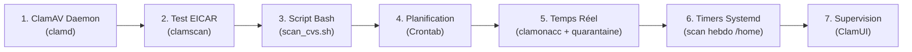

# 🛡️ Projet ClamAV — Sécurisation & Protection Antivirale sous Linux

[-red?logo=debian)](https://www.debian.org/)
[](https://www.clamav.net/)
[](#-compétences-bts-sio-couvertes)
[](procedure_bts_sio_clamav.pdf)

> **Projet BTS SIO SISR :** Déploiement, automatisation et supervision en temps réel de l'antivirus open-source **ClamAV** sur serveur Linux.

---

## 📑 Accès aux Documents Complets

- 📘 **[Procédure technique détaillée (Markdown)](procedure_bts_sio_clamav.md)** — Guide exhaustif avec toutes les commandes et explications pas à pas.
- 📥 **[Rapport officiel BTS SIO (Format PDF)](procedure_bts_sio_clamav.pdf)** — Document formaté prêt pour l'évaluation et le jury.

---

## 🎯 Enjeux & Objectifs

L'objectif de ce projet est de protéger les flux de données d'une infrastructure Linux (partages de fichiers, dépôts applicatifs web) en combinant :
- Une analyse ponctuelle et récurrente des fichiers.
- Une détection et mise en quarantaine automatique en temps réel dès l'écriture d'un fichier.
- Une interface graphique pour faciliter le suivi opérationnel.

---

## ⚡ Synthèse des Étapes Réalisées



| Étape | Action technique | Outils / Commandes clés |
| :--- | :--- | :--- |
| **1. Service démon** | Activation et chargement des signatures en RAM | `systemctl enable --now clamav-daemon` |
| **2. Test de détection** | Validation du moteur avec la signature standard | `clamscan --infected --remove eicar.txt` |
| **3. Automatisation Bash** | Tri automatique des dépôts entrants (`safe` / `infected`) | `scan_cvs.sh` (gestion des codes retours `$?`) |
| **4. Planification périodique** | Automatisation de l'analyse du répertoire de dépôt | `crontab -e` (`*/5 * * * * ...`) |
| **5. Protection temps réel** | Interception des fichiers à la volée via `fanotify` | `clamonacc` + isolation dans `/var/quarantine` |
| **6. Planification Systemd** | Scan hebdomadaire en tâche de fond basse priorité | `scan-home-hebdo.service` (`Nice=19`) + `.timer` |
| **7. IHM d'administration** | Déploiement de l'interface graphique d'audit et de màj | `ClamUI` (`.deb`) pour le suivi `freshclam` |

---

## 🎓 Compétences BTS SIO Couvertes

- **Bloc 1 — Support et mise à disposition de services informatiques :** Gestion et sécurisation du patrimoine informatique.
- **Bloc 2 — Administration des systèmes et des réseaux :** Déploiement de démons Linux, scripts d'administration et ordonnancement (Cron & Systemd).
- **Bloc 3 — Cybersécurité des services informatiques :** Prévention active contre les malwares, gestion de la quarantaine et sécurisation des flux de téléversement.

---

## 📁 Arborescence du Dépôt

```text
├── images/                         # Captures d'écran des manipulations
├── procedure_bts_sio_clamav.md     # Fiche de procédure technique complète
└── README.md                       # Présentation synthétique du projet
```

---
*Projet réalisé dans le cadre de la formation BTS SIO (SISR) — Basé sur la documentation technique [IT-Connect](https://www.it-connect.fr/guide-clamav-installer-et-configurer-un-antivirus-sur-linux/).*
